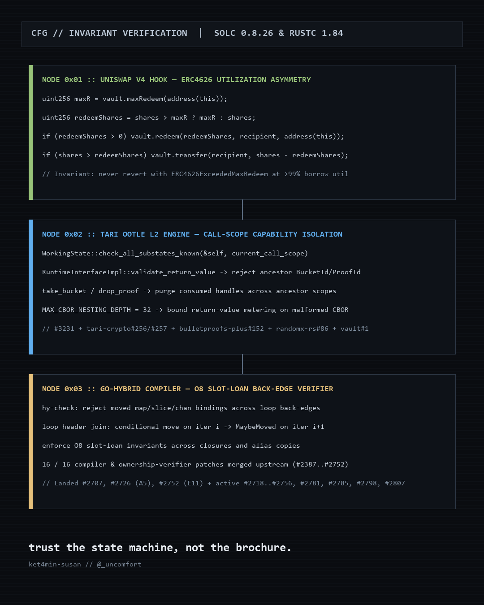

### `ket4min-susan` — Protocol, Binary & Audio DSP Surgeon

Independent systems engineer and protocol security researcher focusing on state-machine invariants, on-chain forensics, and zero-disk acoustic signal processing.

---

#### 1. Protocol & Smart Contract State-Machine Audits (`Rust` · `Solidity` · `Go`)

- **Tari L1, Bulletproofs+ & Ootle L2 (`tari-project/tari`, `tari-project/tari-ootle`, `tari-project/tari-crypto`, `tari-project/bulletproofs-plus`)**
  - **Call-Scope Capability Isolation (`tari-ootle#3231`):** Enforced current call-scope membership in `WorkingState::check_all_substates_known` and `RuntimeInterfaceImpl::validate_return_value`; purged consumed buckets, dropped proofs, and used address allocations across ancestor scopes; bounded WASM CBOR return-value depth by `MAX_CBOR_NESTING_DEPTH`.
  - **Cryptographic Curve & Transcript Invariants (`tari-crypto#256`, `#257`, `bulletproofs-plus#152`, `tari_utilities#81`):** Enforced canonical curve point decompression (`CompressedCommitment::from_canonical_bytes_validated`), domain-separated ComSig signature challenges rejecting zero scalars, and hardened wire serialization formats.
  - **Base Node Canonical Sync (`tari#8212`, `#8214`):** Enforced canonical chain header continuity and full kernel/input/output equality in `BlockBodyPartialValidator`.
  - **wTARI Bridge Contracts & Subgraph (`wxtm-bridge-contracts#52`, `#53`, `wxtm-bridge-subgraph#15`):** Verified Safe fallback handler storage slots and aligned `wTARIBridge` ABI definitions across Base and Base Sepolia.
  - **Tari Ecosystem Rust/FFI & Host Hardening (`randomx-rs#86`, `tari_vault#1`, `tari-tapplet-lib#1`, `utxo-scanner#1`, `wasm-template#74`):** Eliminated FFI mutable aliasing UB in `randomx-rs`, authenticated encryption key derivation in `tari_vault`, enforced Lua host sandboxing in `tari-tapplet-lib`, and resolved `monitor-core` task-map race conditions in `utxo-scanner`.

- **Uniswap v4 Lending Hooks & ERC4626 Vaults (`revert-finance/v4lend`)**
  - **ERC4626 Utilization Asymmetry (`#78`):** Clamped `autoLendForceExit` and `autoLendWithdraw` redemptions to `min(vault.maxRedeem(address(this)), shares)` with direct residual share transfer so high vault utilization cannot revert user exits with `ERC4626ExceededMaxRedeem`.
  - **Tick-Delta Arithmetic & Trigger Preservation (`#85`, `#87`, `#89`):** Widened `int24` tick-delta and tolerance arithmetic prior to clamping; preserved surviving `AUTO_RANGE` / `AUTO_LEVERAGE` mode triggers when remint paths fail.

- **Compiler Ownership & Borrow Verification (`limitlessprojects/Go-Hybrid`)**
  - **16/16 Merged Compiler Patches (`#2387`–`#2752`) + Active `#2718`, `#2741`, `#2756`:** Enforced `O8` slot-loan move invariants across closures, pointer type aliases (`#2707`), parallel key writes, loop back-edges (`#2625`), `A5` foreign-escape closure captures (`#2726`), and `E11` `try_context` handlers (`#2752`) in `hy-check` and `hy-emit`.

---

#### 2. Open-Source Forensics & Low-Level Tooling

- **[`ket4min-susan/otc-taint-permit2-guard`](https://github.com/ket4min-susan/otc-taint-permit2-guard)**  · [Release `v2.6.11`](https://github.com/ket4min-susan/otc-taint-permit2-guard/releases/tag/v2.6.11) · [GitLab Mirror (`@memwm`)](https://gitlab.com/memwm/otc-taint-permit2-guard) — Sub-second on-chain USDT (`0xe47d6060`) & USDC (`0xfe575a87`) blacklist checker and pre-sign EIP-712 `Permit2` (`PermitSingle` word-5 / `PermitBatch` word-4) & allowance (`0x095ea7b3`) ABI calldata disassembler.
- **[`ket4min-susan/fpcalc-stream-dedup`](https://github.com/ket4min-susan/fpcalc-stream-dedup)**  · [Release `v1.0.0`](https://github.com/ket4min-susan/fpcalc-stream-dedup/releases/tag/v1.0.0) · [GitLab Mirror (`@memwm`)](https://gitlab.com/memwm/fpcalc-stream-dedup) — Zero-disk Chromaprint / 28-bit synchsafe ID3-aligned dual-32KB acoustic frame deduplicator and promotional watermark stripper backed by SQLite WAL + FTS5.
- **[`ket4min-susan/flapjax-treasury-audits`](https://github.com/ket4min-susan/flapjax-treasury-audits)**  · [Release `v1.0.0`](https://github.com/ket4min-susan/flapjax-treasury-audits/releases/tag/v1.0.0) · [GitLab Mirror (`@memwm`)](https://gitlab.com/memwm/flapjax-treasury-audits) — Deterministic BSC receipt cluster forensics (`Q76`, `Q78`, `Q80`) grouped by genesis BNB funder.
- **[`ket4min-susan/nanoaddr-ts`](https://github.com/ket4min-susan/nanoaddr-ts)**  · [Release `v1.0.0`](https://github.com/ket4min-susan/nanoaddr-ts/releases/tag/v1.0.0) · [GitLab Mirror (`@memwm`)](https://gitlab.com/memwm/nanoaddr-ts) — Zero-dependency TypeScript port of Nano (`XNO`) address codec and `blake2b-40` checksum validator.
- **[`ket4min-susan/agent-bounty-feed-client`](https://github.com/ket4min-susan/agent-bounty-feed-client)**  · [Release `v1.0.0`](https://github.com/ket4min-susan/agent-bounty-feed-client/releases/tag/v1.0.0) · [GitLab Mirror (`@memwm`)](https://gitlab.com/memwm/agent-bounty-feed-client) — Zero-dependency Python MCP Streamable HTTP & `x402` settlement client.
- **[Public Technical Gist (`8128bd4162b53406f7c55203b2b4afc8`)](https://gist.github.com/ket4min-susan/8128bd4162b53406f7c55203b2b4afc8)** — On-Chain Taint Propagation, Permit2 Calldata Forensics & Verified Mirror Index.

---

#### 3. Contact & Channels
- **X / Twitter:** [`@ket4min141`](https://x.com/ket4min141)
- **GitHub / GitLab:** [`ket4min-susan`](https://github.com/ket4min-susan) / [`@memwm`](https://gitlab.com/memwm) (`memwmain@gmail.com`)

---

