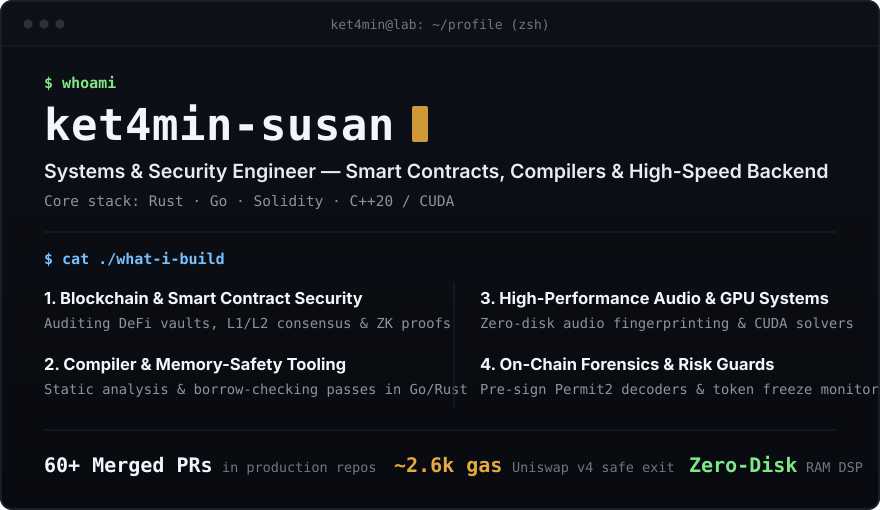

  

 

### Selected Open-Source Contributions

| Project | Area | What I Built / Fixed | Links |
| :--- | :--- | :--- | :--- |
| **Tari (`tari` · `tari-ootle`)** | Layer-1/2 Blockchain (Rust) | Fixed WASM state isolation bugs, bounded CBOR recursion (`depth <= 32`), and enforced Ristretto255 cryptographic checks. | [`#3231`](https://github.com/tari-project/tari-ootle/pull/3231) · [`#8212`](https://github.com/tari-project/tari/pull/8212) · [`#256`](https://github.com/tari-project/tari-crypto/pull/256) |
| **Go-Hybrid (`hy-check`)** | Compiler Static Analysis (Go) | Authored **25+ merged compiler patches** catching memory-aliasing, loop move errors, and closure escape bugs at compile time. | [`#2625`](https://github.com/limitlessprojects/Go-Hybrid/pull/2625) · [`#2707`](https://github.com/limitlessprojects/Go-Hybrid/pull/2707) · [`#2726`](https://github.com/limitlessprojects/Go-Hybrid/pull/2726) |
| **Revert Finance (`v4lend`)** | DeFi Lending Hooks (Solidity) | Prevented user fund lockups during liquidity spikes via atomic `ERC-4626` clamped withdrawals (~2,600 gas) and safe tick math. | [`#78`](https://github.com/revert-finance/v4lend/pull/78) · [`#85`](https://github.com/revert-finance/v4lend/pull/85) · [`#89`](https://github.com/revert-finance/v4lend/pull/89) |

### Featured Projects

* **[`otc-taint-permit2-guard`](https://github.com/ket4min-susan/otc-taint-permit2-guard)** — Security tool that decodes `Permit2` wallet signatures before signing and detects frozen `USDT`/`USDC` addresses in real time.
* **[`fpcalc-stream-dedup`](https://github.com/ket4min-susan/fpcalc-stream-dedup)** — High-speed audio deduplication engine using in-memory Chromaprint fingerprinting and SQLite WAL (zero temporary disk files).
* **[`TARI.Miner`](https://github.com/ket4min-susan/TARI.Miner)** — High-throughput NVIDIA CUDA graph solver (`Cuckaroo29`) written in C++/CUDA.
* **[`nanoaddr-ts`](https://github.com/ket4min-susan/nanoaddr-ts)** — Zero-dependency TypeScript library for `XNO` address encoding and `Blake2b-40` checksum verification.
