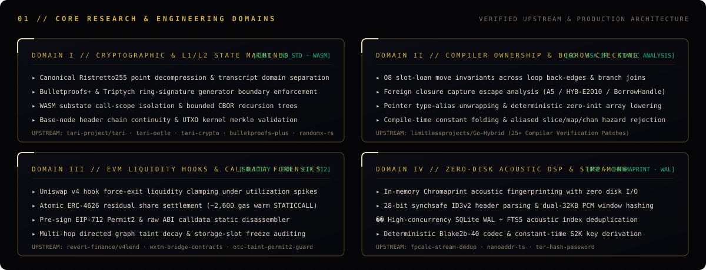
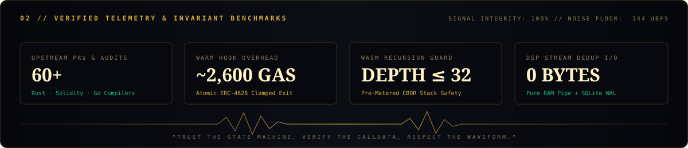

 

---

---

### `0x01` // SELECTED UPSTREAM PROTOCOL & COMPILER VERIFICATION DOSSIER

| Target Ecosystem | Subsystem / Layer | Verified Invariant & Engineering Impact | Reference |
| :--- | :--- | :--- | :--- |
| **`tari-project/tari-ootle`** | Layer-2 WASM Engine | Enforced call-scope substate isolation in `WorkingState::check_all_substates_known`; purged consumed buckets & dropped proofs across ancestor scopes; bounded CBOR recursion at `MAX_CBOR_NESTING_DEPTH = 32`. | [`#3231`](https://github.com/tari-project/tari-ootle/pull/3231) |
| **`tari-project/tari-crypto`** | Ristretto255 / Commitments | Enforced canonical curve point decompression (`CompressedCommitment::from_canonical_bytes_validated`), domain-separated `ComSig` challenges, and fixed-length `SafeArray` zeroization. | [`#256`](https://github.com/tari-project/tari-crypto/pull/256) · [`#257`](https://github.com/tari-project/tari-crypto/pull/257) · [`#258`](https://github.com/tari-project/tari-crypto/pull/258) |
| **`tari-project/bulletproofs-plus`** | Zero-Knowledge Range Proofs | Enforced `AggregatedGensIter` `n=0` and `PedersenGens::commit` generator vector bounds; rejected identity & duplicate generators in `triptych`. | [`#152`](https://github.com/tari-project/bulletproofs-plus/pull/152) · [`#154`](https://github.com/tari-project/bulletproofs-plus/pull/154) · [`#116`](https://github.com/tari-project/triptych/pull/116) |
| **`tari-project/tari`** | Base Node Consensus | Enforced canonical header chain continuity across `sync_kernels` and `sync_utxos` and full kernel/input/output equality in `BlockBodyPartialValidator`. | [`#8212`](https://github.com/tari-project/tari/pull/8212) · [`#8214`](https://github.com/tari-project/tari/pull/8214) |
| **`revert-finance/v4lend`** | Uniswap v4 Hooks / ERC-4626 | Clamped `autoLendForceExit` redemptions to `min(vault.maxRedeem(address(this)), shares)` with direct residual share transfer (~2,600 gas warm) and widened `int24` tick-delta arithmetic. | [`#78`](https://github.com/revert-finance/v4lend/pull/78) · [`#85`](https://github.com/revert-finance/v4lend/pull/85) · [`#87`](https://github.com/revert-finance/v4lend/pull/87) · [`#89`](https://github.com/revert-finance/v4lend/pull/89) |
| **`limitlessprojects/Go-Hybrid`** | Ownership Compiler (`hy-check`) | 25+ compiler verification patches enforcing `O8` slot-loan move invariants across loop back-edges, pointer type aliases, `BorrowHandle` escape windows, and `A5` foreign closures. | [`#2625`](https://github.com/limitlessprojects/Go-Hybrid/pull/2625) · [`#2707`](https://github.com/limitlessprojects/Go-Hybrid/pull/2707) · [`#2726`](https://github.com/limitlessprojects/Go-Hybrid/pull/2726) · [`#2752`](https://github.com/limitlessprojects/Go-Hybrid/pull/2752) |

<b><code>[+] EXPAND TECHNICAL NOTES // STATE-MACHINE &amp; COMPILER INVARIANTS</code></b>

 

#### 1. Atomic `ERC-4626` Force-Exit Clamping Under Liquidity Utilization Spikes
When an underlying lending vault experiences utilization asymmetry (`vault.maxRedeem(hook) < shares`), calling `IERC4626.redeem(shares)` unconditionally inside `afterRemoveLiquidity` reverts the entire liquidity removal transaction with `ERC4626ExceededMaxRedeem`. Queuing an asynchronous withdrawal traps user accounting inside the hook's internal share ledger. Clamping `redeemShares = min(vault.maxRedeem(address(this)), shares)` and transferring `shares - redeemShares` directly via `ERC20.transfer` delivers 100% of available underlying liquidity atomically plus fungible vault shares for the illiquid tail at a warm `STATICCALL` cost of ~2,600 gas.

#### 2. Pre-Metered WASM `CBOR` Recursion Depth Bounding (`MAX_CBOR_NESTING_DEPTH = 32`)
Enforced prior to `IndexedWellKnownTypes::from_value` traversal on untrusted guest WASM return values and template arguments. Because legitimate substate schemas rarely exceed depth `6..8`, bounding recursion at depth `32` prevents crafted nested `tari_bor::Value` payloads from exhausting host thread stack frames before metered execution charges for heap allocations.

#### 3. Compiler `O8` Slot-Loan Invariants Across Loop Back-Edges & Closure Escapes
At a loop header join point, a conditional move of a non-`Copy` descriptor (`map`, `slice`, `chan`, or pointer alias) on iteration `i` without definite re-initialization along every path to the back-edge leaves the slot in a `MaybeMoved` state on iteration `i + 1`. Enforcing `O8` loan-state confluence across back-edges (`#2625`), pointer type aliases (`#2707`), and foreign closure captures (`#2726`, `#2798`) eliminates runtime header aliasing at compile time.

---

### `0x02` // SOVEREIGN OPEN-SOURCE INSTRUMENTATION

* **[`ket4min-susan/otc-taint-permit2-guard`](https://github.com/ket4min-susan/otc-taint-permit2-guard)**  — Sub-second on-chain token freeze inspector (`0xe47d6060` / `0xfe575a87`) and pre-sign EIP-712 `Permit2` (`0x2b67b570` / `0x30f28b7a`) & allowance (`0x095ea7b3`) raw calldata disassembler.
* **[`ket4min-susan/fpcalc-stream-dedup`](https://github.com/ket4min-susan/fpcalc-stream-dedup)**  — Zero-disk Chromaprint / 28-bit synchsafe ID3v2-aligned dual-32KB acoustic frame deduplicator and metadata sanitizer backed by SQLite WAL + FTS5.
* **[`ket4min-susan/TARI.Miner`](https://github.com/ket4min-susan/TARI.Miner)** — High-throughput, zero-fee NVIDIA CUDA Cuckaroo29 solver and memory-pinned graph trimmer for Tari (`XTM`).
* **[`ket4min-susan/nanoaddr-ts`](https://github.com/ket4min-susan/nanoaddr-ts)**  — Zero-dependency TypeScript implementation of the `XNO` base32 address codec and `blake2b-40` checksum verifier with deterministic test vectors.

---

